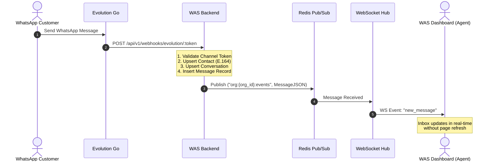

# WAS — System Architecture Specification

---

## 1. Overview

**WAS** is a cloud-native, multi-tenant WhatsApp Customer Relationship Management (CRM) platform. It provides organizations with a unified interface to connect multiple WhatsApp accounts via QR codes, manage inbound and outbound communications across multiple agents, track contacts, and gain operational intelligence.

---

## 2. Architectural Principles

1. **Modular Monolith Backend:** The core backend is engineered as a domain-driven Golang application utilizing Chi router. It maintains clean logical boundaries between modules (`auth`, `organizations`, `channels`, `evolution`, `contacts`, `conversations`, `messages`, `websocket`, `notifications`, `audit`).
2. **Strict Multi-Tenancy:** Data isolation is maintained across all operational entities. Every tenant record references an `organization_id` with foreign key enforcement and database indexing.
3. **Reactive WebSocket Engine:** Inbound events from WhatsApp instances (via Evolution Go webhooks) and outbound messages are broadcast to connected agent interfaces via a high-performance WebSocket hub backed by Redis pub/sub.
4. **Decoupled WhatsApp Gateway:** The WhatsApp protocol engine (`evolution-go`, leveraging `whatsmeow`) runs as an isolated microservice, accessed via authenticated REST API calls and asynchronous webhooks.

---

## 3. High-Level System Architecture

```
┌────────────────────────────────────────────────────────────────────────┐
│                               WAS Frontend                             │
│       React 18 + TypeScript + Vite + Tailwind CSS + shadcn/ui          │
│       TanStack Query (Cache) + Zustand (State) + WebSocket Client      │
└────────────────────────────────────▲───────────────────────────────────┘
                                     │ HTTP REST (/api/v1/) & WebSocket (/ws)
                                     ▼
┌────────────────────────────────────────────────────────────────────────┐
│                               WAS Backend                              │
│                    Golang + Chi Router (Modular Monolith)              │
│                                                                        │
│  ┌───────────────┐  ┌───────────────┐  ┌────────────────────────────┐  │
│  │ Auth & RBAC   │  │ Organizations │  │ WhatsApp Channels Manager  │  │
│  └───────────────┘  └───────────────┘  └─────────────┬──────────────┘  │
│  ┌───────────────┐  ┌───────────────┐                │                 │
│  │ Contacts      │  │ Conversations │                │ REST / Webhooks │
│  └───────────────┘  └───────────────┘                ▼                 │
│  ┌───────────────┐  ┌───────────────┐  ┌────────────────────────────┐  │
│  │ Inbox Engine  │  │ Team & Assign │  │ Evolution Go Adapter       │  │
│  └───────────────┘  └───────────────┘  │ (Live Client + Mock)       │  │
│  ┌───────────────┐  ┌───────────────┐  └─────────────┬──────────────┘  │
│  │ WebSocket Hub │  │ Audit Logger  │                │                 │
│  └───────┬───────┘  └───────────────┘                │                 │
└──────────┼───────────────────────────────────────────┼─────────────────┘
           │ Pub/Sub & Sessions                        │
           ▼                                           │
┌───────────────────────┐                              │
│         Redis         │                              │
│   Cache & Real-time   │                              │
└───────────────────────┘                              │
           ▲                                           │
           │ DB Persistence                            │
           ▼                                           ▼
┌───────────────────────┐            ┌───────────────────────────────────┐
│      PostgreSQL       │            │           Evolution Go            │
│   WAS CRM Database    │            │     WhatsApp Engine (whatsmeow)   │
│   (Multi-tenant DB)   │            │   QR Generation & Session Store   │
└───────────────────────┘            └───────────────────────────────────┘
```

---

## 4. Multi-Tenancy & Authorization Model

### Hierarchy
```
Platform
  └── Organization
        ├── Owner (Billing, Org Destruction, Full Access)
        ├── Admin (User Management, Channel Config, Settings)
        ├── Manager (Conversation Assignment, Contacts, Notes, Reporting)
        └── Agent (Inbox Response, Contact Creation, Internal Notes)
```

### Data Isolation Enforcement
- **Context Injection:** When an HTTP request enters the Chi router, the authentication middleware validates the JWT access token and extracts:
  - `user_id` (UUID)
  - `organization_id` (UUID)
  - `role` (string)
- **Repository Isolation:** All database repositories require `organization_id` as the primary scoping filter in queries.
- **Cross-Tenant Prevention:** Direct queries by ID (e.g., `GetContactByID(id, orgID)`) always combine the target entity ID with the caller's verified `organization_id`.

---

## 5. WhatsApp Integration Architecture

### Evolution Go Microservice
- **Repository:** `third-party/evolution-go`
- **Engine:** `whatsmeow` (Golang library communicating directly with WhatsApp multi-device WebSocket endpoints).
- **Communication Protocol:**
  - **Outbound to WhatsApp:** WAS Backend issues REST requests to Evolution Go (`/instance/create`, `/instance/connect`, `/instance/qr`, `/send/text`, etc.) using HTTP and header `apikey: <instance_token>`.
  - **Inbound from WhatsApp:** Evolution Go triggers HTTP POST webhooks to the WAS Backend endpoint `/api/v1/webhooks/evolution/:token`.

### Dual-Adapter Design Pattern
To enable isolated unit testing, continuous integration, and local development without physical WhatsApp devices, the backend utilizes an `EvolutionGateway` abstraction:
1. `LiveEvolutionClient`: Issues real HTTP requests to the Evolution Go container and validates responses.
2. `MockEvolutionAdapter`: In-memory emulator that delivers mock QR codes, simulates phone pairing, and triggers realistic incoming WhatsApp message webhooks.

---

## 6. Real-Time Event Pipeline


