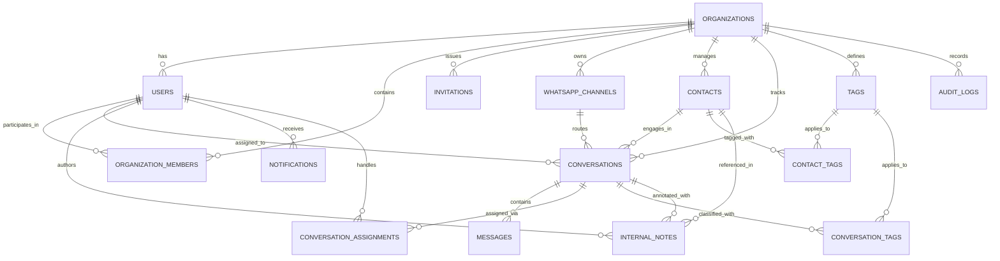

# WAS — Database Architecture & Schema Specification

---

## 1. Overview

**WAS** utilizes PostgreSQL 16 as its relational database. The schema is designed for SaaS multi-tenancy, high-throughput messaging, auditability, and data integrity.

---

## 2. Design Principles

1. **UUID Primary Keys:** All tables use `uuid_generate_v4()` for primary keys to prevent enumeration attacks and support distributed generation.
2. **Strict Foreign Keys:** Foreign keys maintain referential integrity with cascading deletes where appropriate (`ON DELETE CASCADE` for child resources).
3. **Compound Indexes:** Indexes combine `organization_id` with frequently filtered or ordered columns (e.g., `(organization_id, status)`, `(organization_id, created_at DESC)`).
4. **Normalized Contact Identity:** Phone numbers are strictly validated and stored in E.164 format, backed by a unique index `(organization_id, phone_number)`.
5. **Audit Logging:** Security-sensitive operations are captured in an immutable `audit_logs` table.

---

## 3. Entity-Relationship Diagram

---

## 4. Table Definitions

### 1. `organizations`
| Column | Type | Constraints | Description |
|---|---|---|---|
| `id` | UUID | PRIMARY KEY | Unique organization ID |
| `name` | VARCHAR(255) | NOT NULL | Business or organization name |
| `slug` | VARCHAR(255) | NOT NULL, UNIQUE | URL-friendly unique identifier |
| `status` | VARCHAR(50) | NOT NULL, DEFAULT 'active' | active, suspended, trial |
| `settings` | JSONB | NOT NULL, DEFAULT '{}' | Custom business preferences |
| `created_at` | TIMESTAMPTZ | NOT NULL, DEFAULT NOW() | Timestamp of creation |
| `updated_at` | TIMESTAMPTZ | NOT NULL, DEFAULT NOW() | Timestamp of last update |

### 2. `users`
| Column | Type | Constraints | Description |
|---|---|---|---|
| `id` | UUID | PRIMARY KEY | Unique user ID |
| `email` | VARCHAR(255) | NOT NULL, UNIQUE | User login email |
| `password_hash` | VARCHAR(255) | NOT NULL | Argon2id/Bcrypt hashed password |
| `full_name` | VARCHAR(255) | NOT NULL | Full name of user |
| `phone` | VARCHAR(50) | NULL | Optional personal phone |
| `avatar_url` | TEXT | NULL | Profile image URL |
| `is_active` | BOOLEAN | NOT NULL, DEFAULT true | Account status flag |
| `last_login_at` | TIMESTAMPTZ | NULL | Timestamp of last authentication |
| `created_at` | TIMESTAMPTZ | NOT NULL, DEFAULT NOW() | Account creation time |
| `updated_at` | TIMESTAMPTZ | NOT NULL, DEFAULT NOW() | Account update time |

### 3. `organization_members`
| Column | Type | Constraints | Description |
|---|---|---|---|
| `id` | UUID | PRIMARY KEY | Unique membership record ID |
| `organization_id` | UUID | NOT NULL, FK ➔ organizations(id) | Organization scoping |
| `user_id` | UUID | NOT NULL, FK ➔ users(id) | Member user ID |
| `role` | VARCHAR(50) | NOT NULL | Owner, Admin, Manager, Agent |
| `is_active` | BOOLEAN | NOT NULL, DEFAULT true | Member status in this org |
| `created_at` | TIMESTAMPTZ | NOT NULL, DEFAULT NOW() | Member join time |
| `updated_at` | TIMESTAMPTZ | NOT NULL, DEFAULT NOW() | Member update time |
*Unique Constraint: `(organization_id, user_id)`*

### 4. `invitations`
| Column | Type | Constraints | Description |
|---|---|---|---|
| `id` | UUID | PRIMARY KEY | Unique invitation ID |
| `organization_id` | UUID | NOT NULL, FK ➔ organizations(id) | Target organization |
| `email` | VARCHAR(255) | NOT NULL | Invitee email |
| `role` | VARCHAR(50) | NOT NULL | Target role for invitee |
| `token` | VARCHAR(255) | NOT NULL, UNIQUE | Secure redemption token |
| `expires_at` | TIMESTAMPTZ | NOT NULL | Token expiration date |
| `accepted_at` | TIMESTAMPTZ | NULL | Redemption timestamp |
| `created_at` | TIMESTAMPTZ | NOT NULL, DEFAULT NOW() | Invitation issuance time |

### 5. `whatsapp_channels`
| Column | Type | Constraints | Description |
|---|---|---|---|
| `id` | UUID | PRIMARY KEY | Unique channel ID |
| `organization_id` | UUID | NOT NULL, FK ➔ organizations(id) | Owning organization |
| `name` | VARCHAR(255) | NOT NULL | Friendly channel label |
| `phone_number` | VARCHAR(50) | NULL | Connected WhatsApp phone number |
| `instance_name` | VARCHAR(255) | NOT NULL, UNIQUE | Evolution Go instance name |
| `instance_token` | VARCHAR(255) | NOT NULL, UNIQUE | Evolution Go security token |
| `status` | VARCHAR(50) | NOT NULL, DEFAULT 'Disconnected' | Lifecycle connection state |
| `qrcode_base64` | TEXT | NULL | Current pairing QR code |
| `settings` | JSONB | NOT NULL, DEFAULT '{}' | Channel options |
| `last_connected_at`| TIMESTAMPTZ| NULL | Timestamp of last active connection |
| `created_at` | TIMESTAMPTZ | NOT NULL, DEFAULT NOW() | Channel creation time |
| `updated_at` | TIMESTAMPTZ | NOT NULL, DEFAULT NOW() | Channel update time |

### 6. `contacts`
| Column | Type | Constraints | Description |
|---|---|---|---|
| `id` | UUID | PRIMARY KEY | Unique contact ID |
| `organization_id` | UUID | NOT NULL, FK ➔ organizations(id) | Owning organization |
| `phone_number` | VARCHAR(50) | NOT NULL | E.164 normalized phone number |
| `full_name` | VARCHAR(255) | NULL | Customer display name |
| `email` | VARCHAR(255) | NULL | Customer email |
| `avatar_url` | TEXT | NULL | WhatsApp profile picture URL |
| `metadata` | JSONB | NOT NULL, DEFAULT '{}' | Custom customer attributes |
| `created_at` | TIMESTAMPTZ | NOT NULL, DEFAULT NOW() | Creation timestamp |
| `updated_at` | TIMESTAMPTZ | NOT NULL, DEFAULT NOW() | Last update timestamp |
*Unique Constraint: `(organization_id, phone_number)`*

### 7. `conversations`
| Column | Type | Constraints | Description |
|---|---|---|---|
| `id` | UUID | PRIMARY KEY | Unique conversation thread ID |
| `organization_id` | UUID | NOT NULL, FK ➔ organizations(id) | Owning organization |
| `channel_id` | UUID | NOT NULL, FK ➔ whatsapp_channels(id) | Routing WhatsApp channel |
| `contact_id` | UUID | NOT NULL, FK ➔ contacts(id) | Customer contact |
| `assigned_agent_id`| UUID | NULL, FK ➔ users(id) | Currently assigned agent |
| `status` | VARCHAR(50) | NOT NULL, DEFAULT 'open' | open, pending, resolved |
| `last_message_preview`| TEXT | NULL | Snippet of latest message |
| `last_message_time`| TIMESTAMPTZ| NOT NULL, DEFAULT NOW() | Timestamp of latest message |
| `unread_count` | INT | NOT NULL, DEFAULT 0 | Unread message count for agents |
| `created_at` | TIMESTAMPTZ | NOT NULL, DEFAULT NOW() | Conversation inception time |
| `updated_at` | TIMESTAMPTZ | NOT NULL, DEFAULT NOW() | Thread update time |
*Unique Constraint: `(organization_id, channel_id, contact_id)`*

### 8. `messages`
| Column | Type | Constraints | Description |
|---|---|---|---|
| `id` | UUID | PRIMARY KEY | Unique message ID |
| `organization_id` | UUID | NOT NULL, FK ➔ organizations(id) | Owning organization |
| `conversation_id` | UUID | NOT NULL, FK ➔ conversations(id) | Parent conversation thread |
| `whatsapp_message_id`| VARCHAR(255)| NULL, UNIQUE | Evolution Go / WhatsApp message ID |
| `sender_type` | VARCHAR(50) | NOT NULL | customer, agent, system |
| `sender_user_id` | UUID | NULL, FK ➔ users(id) | User ID if sent by agent |
| `message_type` | VARCHAR(50) | NOT NULL, DEFAULT 'text' | text, image, audio, video, doc |
| `body` | TEXT | NULL | Textual message content |
| `media_url` | TEXT | NULL | Storage URL for media attachments |
| `media_mime_type` | VARCHAR(100)| NULL | MIME type of media file |
| `delivery_status` | VARCHAR(50) | NOT NULL, DEFAULT 'pending' | pending, sent, delivered, read, failed |
| `raw_payload` | JSONB | NULL | Full webhook payload from engine |
| `sent_at` | TIMESTAMPTZ | NOT NULL, DEFAULT NOW() | Message delivery timestamp |
| `created_at` | TIMESTAMPTZ | NOT NULL, DEFAULT NOW() | Database record insertion time |

### 9. `conversation_assignments`
| Column | Type | Constraints | Description |
|---|---|---|---|
| `id` | UUID | PRIMARY KEY | Assignment record ID |
| `organization_id` | UUID | NOT NULL, FK ➔ organizations(id) | Scoping organization |
| `conversation_id` | UUID | NOT NULL, FK ➔ conversations(id) | Assigned thread |
| `assigned_to_user_id`| UUID | NOT NULL, FK ➔ users(id) | Recipient agent |
| `assigned_by_user_id`| UUID | NOT NULL, FK ➔ users(id) | Assigning manager or system |
| `reason` | TEXT | NULL | Handover note / assignment reason |
| `created_at` | TIMESTAMPTZ | NOT NULL, DEFAULT NOW() | Timestamp of assignment |

### 10. `internal_notes`
| Column | Type | Constraints | Description |
|---|---|---|---|
| `id` | UUID | PRIMARY KEY | Note ID |
| `organization_id` | UUID | NOT NULL, FK ➔ organizations(id) | Scoping organization |
| `conversation_id` | UUID | NOT NULL, FK ➔ conversations(id) | Associated conversation |
| `contact_id` | UUID | NOT NULL, FK ➔ contacts(id) | Associated contact |
| `user_id` | UUID | NOT NULL, FK ➔ users(id) | Author user ID |
| `content` | TEXT | NOT NULL | Private team note content |
| `created_at` | TIMESTAMPTZ | NOT NULL, DEFAULT NOW() | Creation timestamp |
| `updated_at` | TIMESTAMPTZ | NOT NULL, DEFAULT NOW() | Last edit timestamp |
*(Note: Internal notes are strictly excluded from WhatsApp transmission).*

### 11. `tags`
| Column | Type | Constraints | Description |
|---|---|---|---|
| `id` | UUID | PRIMARY KEY | Tag ID |
| `organization_id` | UUID | NOT NULL, FK ➔ organizations(id) | Scoping organization |
| `name` | VARCHAR(100) | NOT NULL | Tag label |
| `color_hex` | VARCHAR(7) | NOT NULL, DEFAULT '#6B7280'| Color badge code |
| `created_at` | TIMESTAMPTZ | NOT NULL, DEFAULT NOW() | Creation timestamp |
*Unique Constraint: `(organization_id, name)`*

### 12. `contact_tags`
| Column | Type | Constraints | Description |
|---|---|---|---|
| `contact_id` | UUID | NOT NULL, FK ➔ contacts(id) ON DELETE CASCADE | Target contact |
| `tag_id` | UUID | NOT NULL, FK ➔ tags(id) ON DELETE CASCADE | Associated tag |
| `created_at` | TIMESTAMPTZ | NOT NULL, DEFAULT NOW() | Association timestamp |
*Primary Key: `(contact_id, tag_id)`*

### 13. `conversation_tags`
| Column | Type | Constraints | Description |
|---|---|---|---|
| `conversation_id` | UUID | NOT NULL, FK ➔ conversations(id) ON DELETE CASCADE | Target thread |
| `tag_id` | UUID | NOT NULL, FK ➔ tags(id) ON DELETE CASCADE | Associated tag |
| `created_at` | TIMESTAMPTZ | NOT NULL, DEFAULT NOW() | Association timestamp |
*Primary Key: `(conversation_id, tag_id)`*

### 14. `notifications`
| Column | Type | Constraints | Description |
|---|---|---|---|
| `id` | UUID | PRIMARY KEY | Notification ID |
| `organization_id` | UUID | NOT NULL, FK ➔ organizations(id) | Scoping organization |
| `user_id` | UUID | NOT NULL, FK ➔ users(id) | Recipient user |
| `title` | VARCHAR(255) | NOT NULL | Notification headline |
| `message` | TEXT | NOT NULL | Notification body |
| `type` | VARCHAR(50) | NOT NULL | new_message, assignment, alert |
| `is_read` | BOOLEAN | NOT NULL, DEFAULT false | Read indicator |
| `metadata` | JSONB | NOT NULL, DEFAULT '{}' | Linked resource identifiers |
| `created_at` | TIMESTAMPTZ | NOT NULL, DEFAULT NOW() | Timestamp |

### 15. `audit_logs`
| Column | Type | Constraints | Description |
|---|---|---|---|
| `id` | UUID | PRIMARY KEY | Audit log entry ID |
| `organization_id` | UUID | NOT NULL, FK ➔ organizations(id) | Scoping organization |
| `user_id` | UUID | NULL, FK ➔ users(id) | Acting user |
| `action` | VARCHAR(100) | NOT NULL | Action identifier |
| `entity_type` | VARCHAR(100) | NOT NULL | Target entity type |
| `entity_id` | UUID | NULL | Target entity primary key |
| `details` | JSONB | NOT NULL, DEFAULT '{}' | State diff or metadata |
| `ip_address` | VARCHAR(45) | NULL | Client IP address |
| `user_agent` | TEXT | NULL | Client user agent |
| `created_at` | TIMESTAMPTZ | NOT NULL, DEFAULT NOW() | Immutable timestamp |
